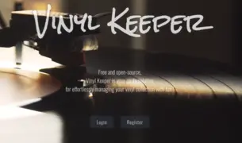
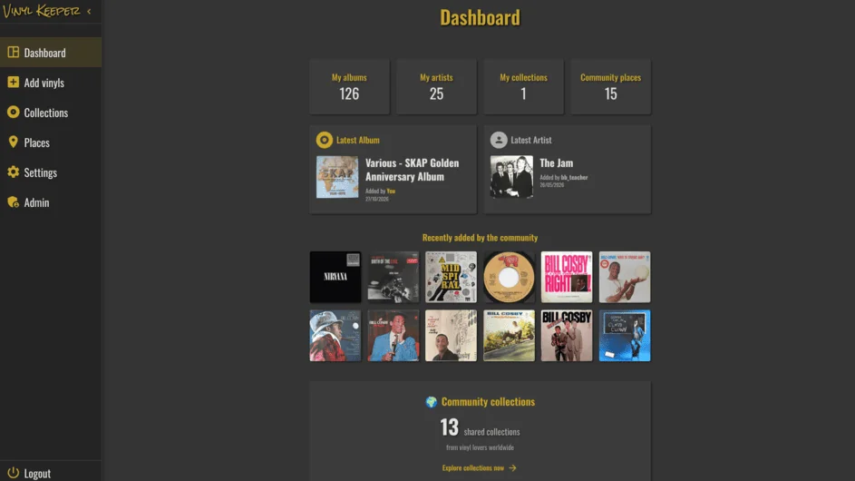
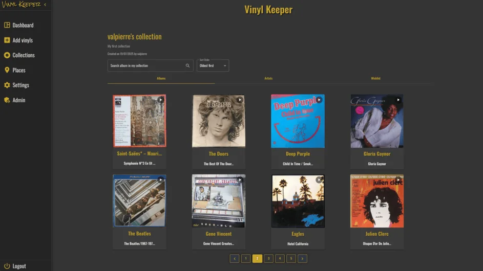
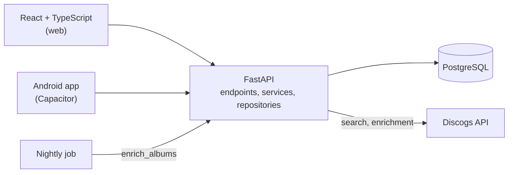

# Vinyl Keeper


**VinylKeeper** is a free and open source app to manage your vinyl collection, share it with a community of collectors, and decide what to put on the turntable tonight.

It is **live in production** at **[vinylkeeper.org](https://vinylkeeper.org/)**, on the web and as an Android app.

<p align="center">
  <a href="https://vinylkeeper.org/">
    
  </a>
</p>

## Features

**🎧 Spinning now**
Pick a mood, an era, a genre or a collection, and get records from your own shelves. "Surprise me" draws one at random and opens it in Deezer, Spotify or YouTube Music.

**📀 Collections**
Organize your records into collections and keep a wishlist. Own the same record more than once? Each copy keeps its own record condition, cover condition and acquisition date, and the cover shows a ×2, ×3 badge. Different pressings of the same album share a single cover, with one section per pressing. Export everything to CSV or ODS, one row per copy.

**👥 Community**
Make a collection public, browse and like other collectors' collections.

**➕ Add a record, from anywhere**
A floating "Add a record" button opens a quick search of the Discogs catalogue on any page. Every result shows its pressing (year, country, label, catalogue number, format) so you add the exact one on your shelf, to any collection or to your wishlist. Adding a record you already own asks whether it is another copy or another pressing. Genres, styles, years and moods are filled in automatically in the background.

**🔎 The right pressing**
Records added before pressings were shown can be confirmed in one click, or switched to the pressing you actually own, keeping their copies and conditions.

**🌍 Places**
A community map of record shops, flea markets and vinyl spots. New places go through moderation.

**📊 Dashboard**
Your collection at a glance and what the community added recently.

**📱 Web and mobile**
Responsive web app and Android app built with Capacitor.

<p align="center">
  
  
</p>

## Technical highlights

### Data enrichment and moods, with no LLM at runtime

Records are enriched once from Discogs (genres, styles, pressing year, original year from the master release), then stored. Features never call Discogs at request time.

Moods (calm, groovy, laid back, dark...) come from **400+ versioned rules** mapping Discogs styles and genres to moods, kept in [`tag_mood_rules.py`](vinylkeeper_back/app/data/tag_mood_rules.py) and reviewed like code.

**Why no LLM at runtime?** The structured data was already there. Rules are deterministic, explainable and free, and the "Spinning now" queries are indexed SQL running in **under 4 ms** for the largest collection (measured with `EXPLAIN ANALYZE` on production data). No per-user AI cost, no latency, no user data sent to a third party. An LLM remains an optional offline enrichment step, and user or LLM moods would always take precedence over rules (`user` > `llm` > `rule`).

Other details:
- **Copies and pressings**: a Discogs master groups every pressing of a work. Collection grids, counters, Spinning now and the dashboard all count works, so a record never shows twice, while each physical copy lives in its own table with its own condition.
- **Reissues are dated correctly**: a 2019 pressing of *Kind of Blue* is filed under the 1950s, thanks to the master release year.
- **Resilient to Discogs rate limits**: requests are throttled to the 60/min limit with backoff, the backfill is resumable, and a nightly job catches up anything that failed.

### Security
- JWT (RS256) in **HttpOnly cookies**, with refresh tokens and **CSRF double-submit** protection
- Argon2 password hashing
- Image proxy with a domain allowlist and size limits (SSRF protection), with on-disk caching

### Architecture



- **Backend**: layered architecture (endpoints, services, repositories) with dependency injection through FastAPI `Depends`, async SQLAlchemy 2 with explicit loading (`lazy="raise"`), Alembic migrations.
- **Frontend**: React 19, TypeScript in strict mode, TanStack Query, MUI, custom hooks for data logic.
- **Quality**: extensive backend and frontend test suites to prevent regressions and bugs: unit, endpoint and real-database integration tests run inside rolled-back transactions on the backend, Vitest and Testing Library on the frontend, plus flake8 and ESLint.
- **Deployment**: Docker Compose on a Linux VPS, migrations applied on container start.

## Getting started

### Prerequisites
- [Python](https://www.python.org/) 3.12 and [Poetry](https://python-poetry.org/)
- [Node.js](https://nodejs.org/) and npm
- [PostgreSQL](https://www.postgresql.org/) 17, for example with [Docker](https://docs.docker.com/)
- A free [Discogs API token](https://www.discogs.com/settings/developers)

### Backend

```bash
git clone https://github.com/quentingenet/vinylkeeper.git
cd vinylkeeper/vinylkeeper_back
poetry install
```

1. Create `app/.env.development` from [`app/.env.template.contributors`](vinylkeeper_back/app/.env.template.contributors) (database, SMTP, Discogs token...).
2. Generate the RSA key pair used to sign JWTs:
   ```bash
   mkdir -p app/keys
   openssl genrsa -out app/keys/private_key.pem 2048
   openssl rsa -in app/keys/private_key.pem -pubout -out app/keys/public_key.pem
   ```
3. Create the database schema and start the API:
   ```bash
   poetry run alembic upgrade head
   poetry run uvicorn app.main:app --reload --port 8000
   ```

The API runs at **http://localhost:8000**, with interactive docs at **/docs**.

Optional, to fill in Discogs metadata and moods for existing records:
```bash
poetry run python -m app.cli.sync_mood_rules       # load the mood rules
poetry run python -m app.cli.enrich_albums         # fetch Discogs metadata, then assign moods
```

### Frontend

```bash
cd vinylkeeper/vinylkeeper_front
npm install
npm run dev
```

Open **http://localhost:5173**. The API URL is set in [`.env.development`](vinylkeeper_front/.env.development).

### Tests

```bash
cd vinylkeeper_back && poetry run pytest
cd vinylkeeper_front && npm run test
```

Unit and endpoint tests need no database and no `.env` file: the test settings are set in [`tests/conftest.py`](vinylkeeper_back/tests/conftest.py).

The real-database integration tests run against a local PostgreSQL copy of the database, migrated with `alembic upgrade head` (some tests read existing albums). Each test runs inside a transaction rolled back at the end, so nothing is ever written. Point them to the database in `vinylkeeper_back/.env.test`, a file ignored by git:

```bash
TEST_DATABASE_URL=postgresql+asyncpg://<user>:<password>@localhost:5432/<database>
```

You can also export `TEST_DATABASE_URL` in your shell instead. Without it, the real-database tests are skipped and the other tests still run.

## Contributing

Contributions are welcome:

1. Fork the repository.
2. Create a feature branch from `main` (`git checkout -b feat/amazing-feature`).
3. Run the tests and linters (`poetry run pytest`, `poetry run flake8 app tests`, `npm run test`, `npm run lint`).
4. Open a Pull Request.

## License

VinylKeeper is released under the [GNU GPL v3](LICENSE). You are free to use, study, share and modify it, as long as modified versions stay free under the same license.

## Author

**Quentin Genet**, full stack developer (React, TypeScript, FastAPI, PostgreSQL).

If you love vinyl, music and web development, contributions and feedback are very welcome.
